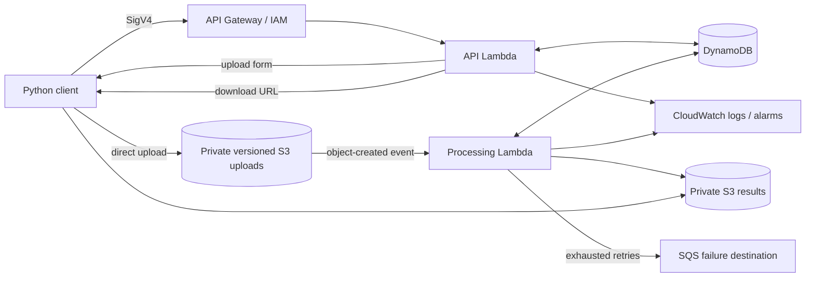

# Serverless Data API

[](https://github.com/Ali-Erturk/serverless-data-api/actions/workflows/checks.yml)

A Python backend for asynchronous CSV and JSON dataset ingestion on AWS. Upload a dataset,
track its processing status, and download normalized JSON with row counts and column metadata.

**Stack:** Python · AWS Lambda · API Gateway · S3 · DynamoDB · SQS · CloudWatch · Terraform · GitHub Actions

## Features

- Three IAM-authorized API routes for upload creation, dataset status, and result downloads.
- Direct-to-S3 uploads using short-lived forms with server-generated keys and exact size constraints.
- CSV and flat JSON validation with explicit byte, row, column, and processing limits.
- Asynchronous processing with SHA-256 verification and immutable input-version selection.
- Conditional DynamoDB leases and attempt tokens to handle duplicate events and interrupted workers.
- Private encrypted storage, scoped IAM roles, failure capture, structured logs, and cleanup policies.
- A SigV4 Python client and an offline example using in-memory AWS service models.

## Architecture



File bytes travel directly between the client and S3. The API handles metadata and temporary access,
while the worker validates and normalizes each dataset. Separate buckets prevent processing loops.

## Quick start

Requirements: Python 3.12. Local examples and tests run without an AWS account or Docker.

```powershell
git clone https://github.com/Ali-Erturk/serverless-data-api.git
cd serverless-data-api
python -m venv .venv
.\.venv\Scripts\Activate.ps1
python -m pip install --require-hashes -r requirements-dev.lock
python -m pip install --no-deps --no-build-isolation -e .
python scripts/local_demo.py
pytest --cov=data_api --cov-report=term-missing --cov-fail-under=85
```

On Linux/macOS, activate the environment with `source .venv/bin/activate`.
The local example processes both sample formats, prints their normalized results, rejects malformed
CSV, and replays events to demonstrate idempotent completion. Moto provides the in-memory S3 and
DynamoDB models.

Example normalized result:

```json
{
  "schema_version": 1,
  "summary": {"row_count": 1, "columns": ["sku", "quantity"], "input_bytes": 21},
  "records": [{"sku": "A100", "quantity": "12"}]
}
```

CSV values remain strings. JSON strings, finite numbers, booleans, and null retain their types.

## API

| Route | Behavior | Success |
| --- | --- | --- |
| `POST /uploads` | Create a dataset ID and constrained S3 upload form | `201` |
| `GET /datasets/{id}` | Read state, timestamps, summary, or validation errors | `200` |
| `GET /datasets/{id}/download` | Issue a short-lived URL for a completed result | `200` |

Create-upload body:

```json
{"format":"csv","size_bytes":21,"sha256":"<64 lowercase hex digits of the file's SHA-256>"}
```

The client calculates the actual byte length and digest. Upload forms and download URLs expire after
300 seconds, or earlier when their signing credentials expire. Application errors use fixed codes
and a request ID; invalid requests return `400`, unknown datasets `404`, and unavailable results `409`.

Every route uses API Gateway `AWS_IAM`. The client signs requests for service `execute-api` using the
AWS credential chain. Terraform creates a scoped caller policy; callers need no direct S3 or DynamoDB
access. Presigned forms and URLs grant temporary access and should be treated as secrets.

## Data contract

| Constraint | Limit |
| --- | --- |
| File size | 1 byte–1 MiB |
| Rows | 1–10,000 |
| Columns | 1–100, consistent across records |
| Column names | Unique, nonblank, up to 128 UTF-8 bytes |
| String values | Up to 4,096 UTF-8 bytes |
| Results | Up to 8 MiB |
| Worker execution | 30-second Lambda timeout; 10-second cooperative validation budget |

CSV requires a header and matching row widths; quoted fields, CRLF, and an optional UTF-8 BOM are
supported. JSON requires a nonempty array of flat objects. Duplicate keys, nested values, NUL
characters, nonfinite numbers, empty inputs, and malformed records are rejected.

## Processing and recovery

Datasets move through `awaiting_upload`, `processing`, `completed`, and `failed`. The first successfully
claimed S3 event version becomes the immutable input for that job. A 60-second lease permits recovery
after interrupted execution, and attempt tokens fence completion updates. Each attempt writes a
distinct result key so stale workers cannot overwrite a published result.

Validation errors are terminal. Transient failures are raised for Lambda asynchronous retries;
exhausted invocations are retained in SQS. Jobs still awaiting upload or processing after 30 minutes
report `JOB_EXPIRED`. Results and metadata have seven-day application retention. S3 lifecycle and
DynamoDB TTL provide eventual cleanup.

The API is single tenant: authorized callers share the dataset namespace. POST upload creation is
not idempotent, forms can be reused until expiry, and automatic re-drive is outside the current scope.
See [design decisions](docs/design-decisions.md) for ownership, permissions, and recovery details.

## Testing and development

The 71-test suite covers the API contract, parsing boundaries, malformed input, result generation,
checksum failures, duplicate events, upload replay, transient storage failures, expired leases,
stale completion, Lambda entry points, and client signing. Application coverage is 97.78%; client
transport behavior is tested separately from that percentage.

Unit tests use Moto and injected faults. Terraform tests use a mocked provider to check route
authorization, bucket access controls, input versioning, lease/runtime compatibility, retries, and
safe deletion defaults. GitHub Actions runs lint, formatting, tests, Linux package assembly, and
Terraform validation. See [development](docs/development.md) for commands and dependency locking.

## AWS deployment

The [deployment guide](docs/deployment.md) covers account configuration, Terraform plan/apply,
caller permissions, signed client requests, service integration checks, observability, costs,
and teardown.

```powershell
python scripts/build_lambda.py
terraform -chdir=infra init -input=false -lockfile=readonly
# Configure infra/terraform.tfvars for your AWS account, then review a Terraform plan.
```

API Gateway, Lambda, S3, DynamoDB, SQS, CloudWatch, and data transfer can incur charges. Review the
resource plan and regional pricing before applying it. Log retention, alarms, lifecycle rules, and
an explicit teardown procedure are included.
