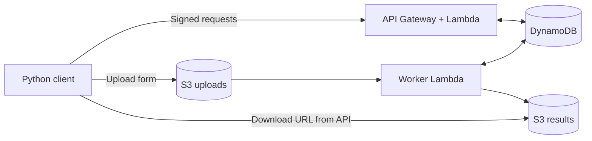

# Serverless Data API

[](https://github.com/Ali-Erturk/serverless-data-api/actions/workflows/checks.yml)

Upload a CSV or JSON file, get a job ID back, and download normalized JSON when processing finishes.
The API handles small datasets and runs on AWS Lambda, with S3 for files and DynamoDB for job status.

## How it works

1. The client asks the API for an upload form.
2. The file goes straight to a private S3 bucket.
3. S3 triggers a worker that checks the file and converts it to JSON.
4. The client polls the job status, then downloads the result from a separate bucket.



The worker checks the file's size and SHA-256 before processing it. S3 can send the same event more
than once, so DynamoDB updates track which worker owns the job. Upload versioning and separate result
keys keep a repeated upload or an old worker from replacing a completed result.

## Run it locally

You'll need Python 3.12. The local example uses Moto to simulate AWS services, so you don't need an
AWS account or Docker to try it.

```powershell
git clone https://github.com/Ali-Erturk/serverless-data-api.git
cd serverless-data-api
python -m venv .venv
.\.venv\Scripts\Activate.ps1
python -m pip install --require-hashes -r requirements-dev.lock
python -m pip install --no-deps --no-build-isolation -e .
python scripts/local_demo.py
```

On Linux/macOS, use `source .venv/bin/activate` to activate the environment.

The example runs both sample files, prints the results, and shows what happens with a malformed CSV
and repeated events. CSV values stay as strings; JSON values keep their original scalar types.

## Endpoints

All three routes use IAM authentication. The Python client signs requests using your AWS credentials.

| Request | What it does |
| --- | --- |
| `POST /uploads` | Returns a dataset ID and a five-minute S3 upload form |
| `GET /datasets/{id}` | Returns the job's status, summary, or validation error |
| `GET /datasets/{id}/download` | Returns a five-minute download URL once the result is ready |

Jobs move through `awaiting_upload`, `processing`, `completed`, and `failed`. Results include the
records, row count, column names, and input size. The client calculates the upload size and checksum.

## Limits and failure handling

Files must be UTF-8 CSV with a header, or JSON arrays of flat objects with matching columns. The
limits are 1 MiB per upload, 10,000 rows, 100 columns, and 4,096 UTF-8 bytes per string value.
Empty files, mismatched CSV rows, nested JSON, and duplicate headers or keys are rejected.

Temporary processing failures are retried; exhausted invocations go to an SQS failure queue. Jobs
that don't finish within 30 minutes report an expiry error. Results and metadata expire after seven
days. The API is single tenant, so authorized callers share the same dataset namespace.

## Tests

```powershell
pytest --cov=data_api --cov-report=term-missing --cov-fail-under=85
ruff check .
```

There are 71 tests covering file validation, API responses, result contents, duplicate events,
worker retries, expired leases, and request signing. AWS calls use Moto and injected failures.
GitHub Actions also builds the Linux Lambda package and checks the Terraform configuration.

## Deploying to AWS

Terraform sets up the API, Lambda functions, private buckets, DynamoDB table, failure queue, logs,
and alarms. The [deployment guide](docs/deployment.md) walks through configuration, using the signed
client, checking the services, and tearing everything down. AWS usage can incur charges, including
storage, requests, logs, and alarms.

More detail: [design decisions](docs/design-decisions.md) · [development setup](docs/development.md).
